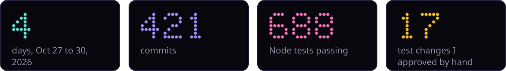
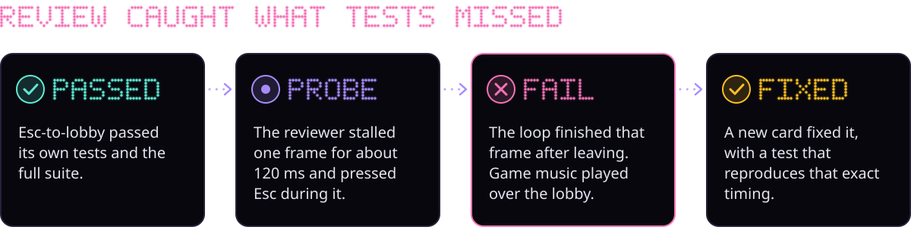
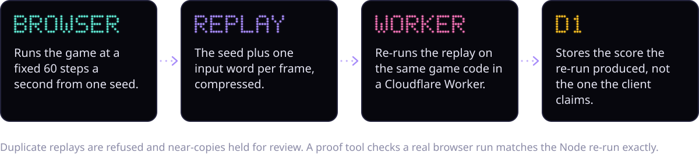

<p align="center">
  <a href="https://staticade.com"></a>
</p>

<p align="center"><b>Original browser arcade games, drawn entirely in glowing dots.</b></p>

<p align="center">
  <a href="https://staticade.com"></a>
  <a href="#how-it-was-built"></a>
  <a href="docs/design.md"></a>
  <a href="server/README.md"></a>
</p>


<table>
  <tr>
    <td width="50%"></td>
    <td width="50%"></td>
  </tr>
</table>


<a name="how-it-was-built"></a>


I directed a team of AI coding agents. They wrote the code; I set the goals and rules, approved every change to an existing test, and played every build.




| What I did | What the agents did |
|---|---|
| Set the goals, their order, and the rules every agent follows | Wrote all the runtime code: engine, game, lobby, server, tools |
| Answered design questions and sent back what felt wrong in playtests | Wrote the tests, the design spec and notes on every change |
| Approved or refused each change to an existing test | Planned the cards, built them, and reviewed each other's work |

**Tests are append-only for agents.** An agent can add tests but not edit or delete one to make something pass. When a design change made an old test wrong, the agent wrote down the exact old and new assertion and I approved or refused it. Each approval is its own labelled commit. One builder loosened its own test; the reviewer flagged it and it was not merged.






**Honest limits.** Every reviewer was a Claude model too, just a fresh instance; no outside human has reviewed the code. Determinism is proven on Chrome's engine only. There is no real-player data yet. The full write-up, including how originality was checked, is in [HOW-IT-WAS-BUILT.md](HOW-IT-WAS-BUILT.md).


```
npm run serve                     # open http://localhost:8770
npm install && npm run test:all   # Node and headless browser tests
```

No build step and zero runtime dependencies.

<sub>Source-available, all rights reserved. See [LICENSE](LICENSE).</sub>


