<p align="center">
  <a href="https://staticade.com">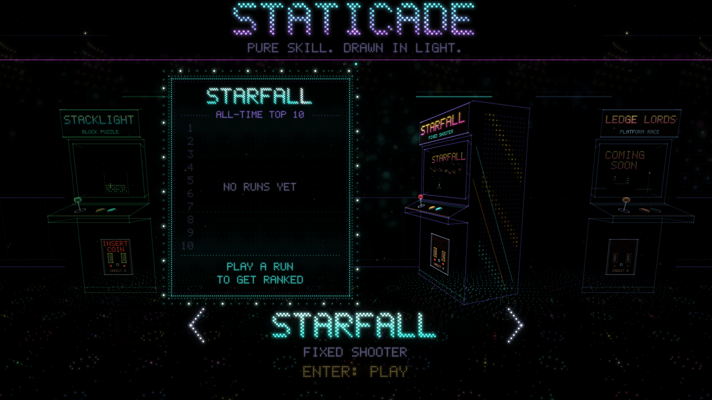</a>
</p>

<p align="center"><b>Original browser arcade games, drawn entirely in glowing dots.</b><br><sub>STARFALL and STACKLIGHT are live. LEDGE LORDS is next.</sub></p>

<p align="center">
  <a href="https://staticade.com">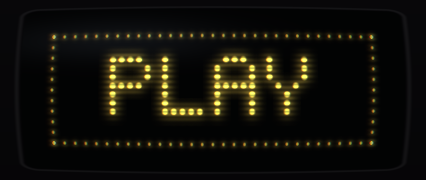</a>
  <a href="#how-it-was-built">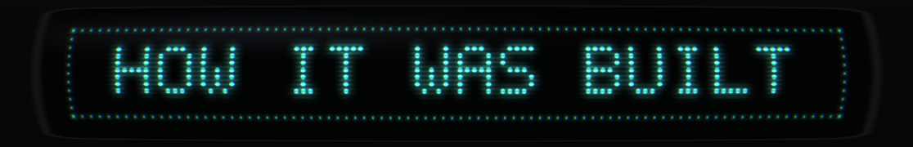</a>
  <a href="docs/design.md">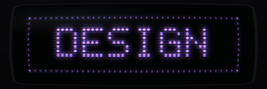</a>
  <a href="server/README.md">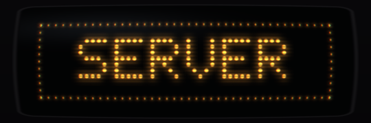</a>
</p>

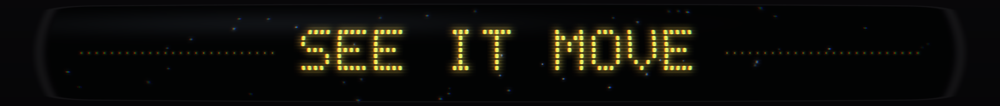

<table>
  <tr>
    <td width="50%">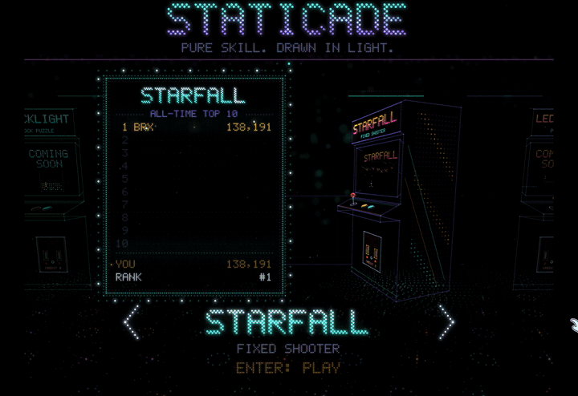</td>
    <td width="50%">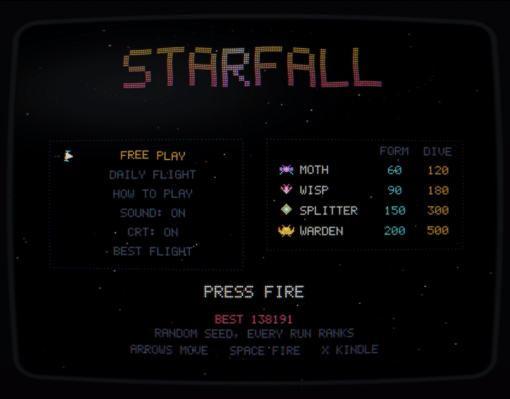</td>
  </tr>
</table>

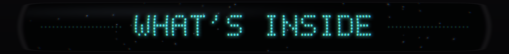

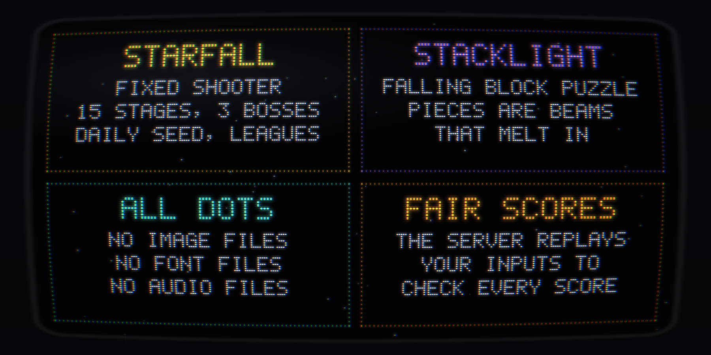

<a name="how-it-was-built"></a>
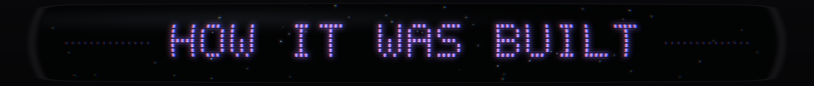

I designed Staticade and ran the build on my own workflow and governance layer for Claude Code. Agents wrote the code; I steered the whole time. Whenever an agent hit a call it shouldn't make alone (taste, originality, scope, a test change, or a risky command or hook), it stopped, showed me the code or command, explained what it would do, and asked how I wanted to handle it. I playtested every build and sent back what felt wrong.

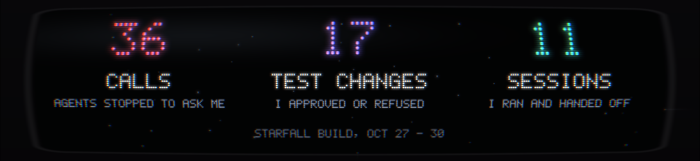

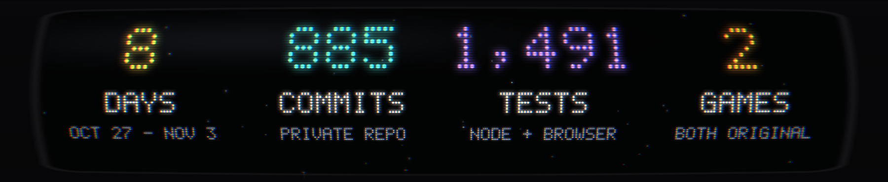


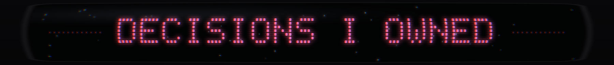


| What I did | What the agents did |
|---|---|
| Designed the workflow and governance layer the agents ran on. Set the goals, their order and the rules | Wrote all the runtime code: engine, game, lobby, server, tools |
| Set the design direction (original answers to the classics, every system explainable in one line) and made the taste, scope and originality calls | Researched the classics and wrote the design spec with its numbers, the tests and notes on every change |
| Playtested every build, approved or refused each test change, and kept merges, deploys and purchases as my call | Planned the cards, built them, and reviewed each other's work |

**Tests are append-only for agents.** An agent can add tests but not edit or delete one to make something pass. When a design change made an old test wrong, the agent wrote down the exact old and new assertion and I approved or refused it. Each approval is its own labelled commit. One builder loosened its own test; the reviewer flagged it and it was not merged.

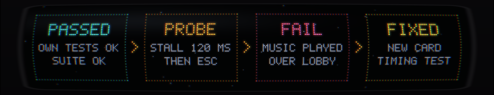

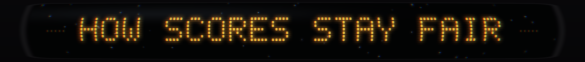

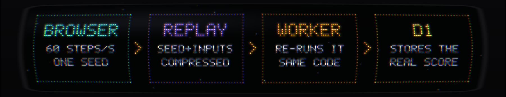

The full write-up, including how originality was checked, is in [HOW-IT-WAS-BUILT.md](HOW-IT-WAS-BUILT.md).

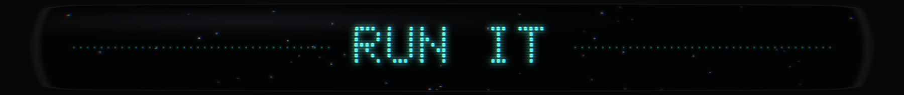

```
npm run serve                     # open http://localhost:8770
npm install && npm run test:all   # Node and headless browser tests
```

No build step and zero runtime dependencies.

Every picture on this page was drawn by the game's own dot renderer, font and CRT pass. The scenes are in [tools/readme](tools/readme).

<sub>Source-available, all rights reserved. See [LICENSE](LICENSE).</sub>


