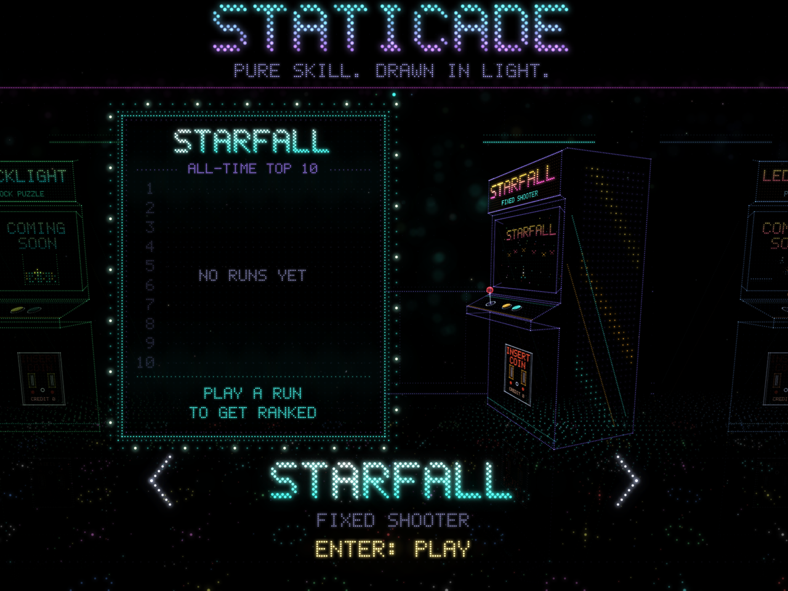
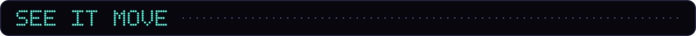
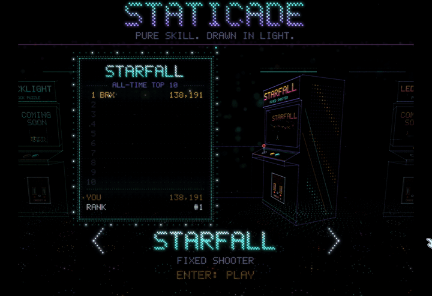
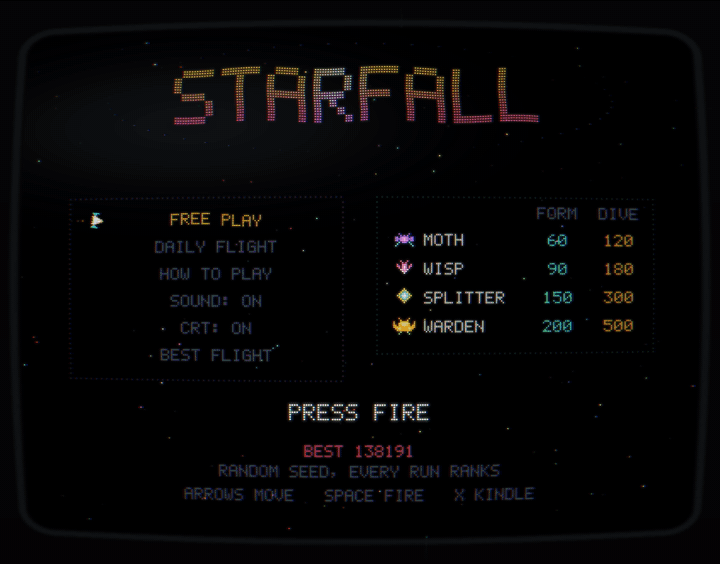
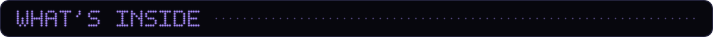
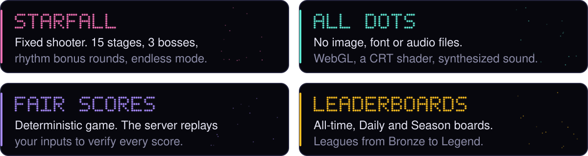
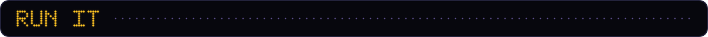

<p align="center">
  <a href="https://staticade.com"></a>
</p>

<p align="center"><b>Original browser arcade games, drawn entirely in glowing dots.</b></p>

<p align="center">
  <a href="https://staticade.com"></a>
  <a href="HOW-IT-WAS-BUILT.md"></a>
  <a href="docs/design.md"></a>
  <a href="server/README.md"></a>
</p>



<table>
  <tr>
    <td width="50%"></td>
    <td width="50%"></td>
  </tr>
</table>







```
npm run serve                     # open http://localhost:8770
npm install && npm run test:all   # Node and headless browser tests
```

No build step and zero runtime dependencies. Built by one person directing a team of AI coding agents: [how it was built](HOW-IT-WAS-BUILT.md).

<sub>Source-available, all rights reserved. See [LICENSE](LICENSE).</sub>


